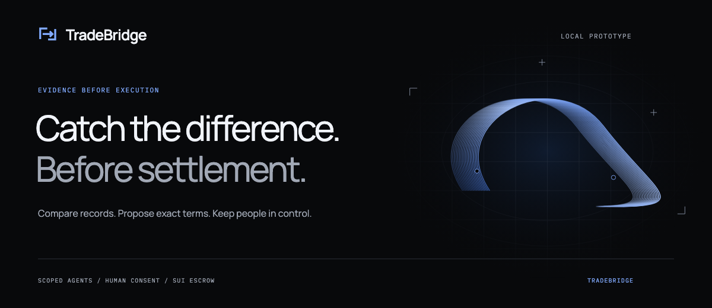
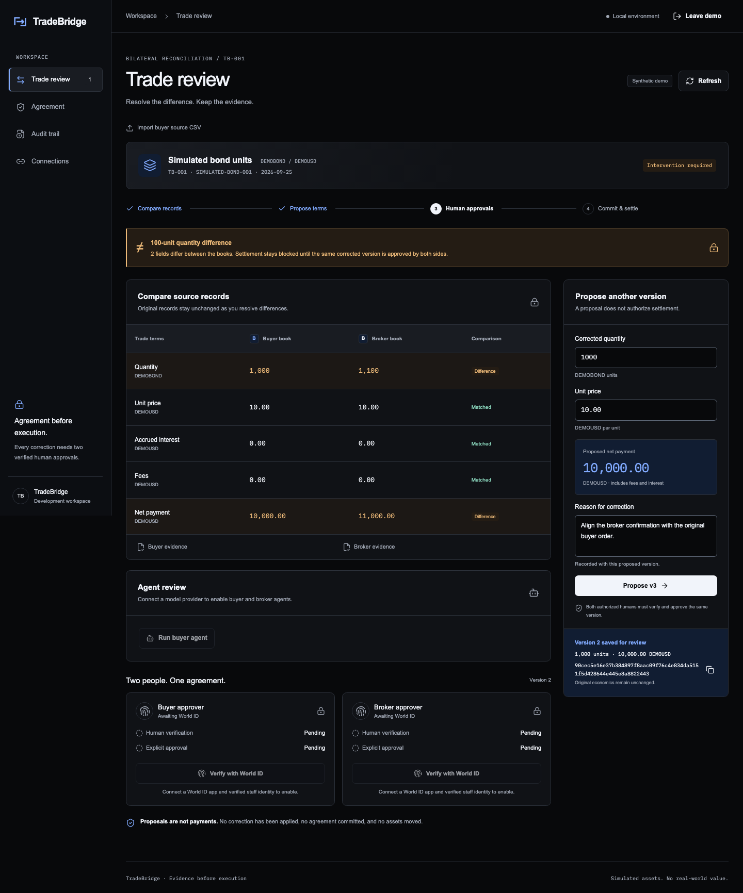
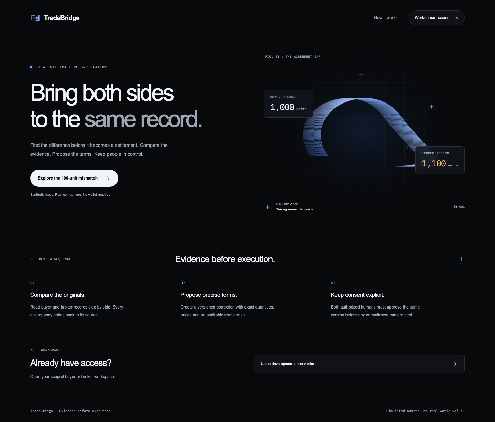

<a id="top"></a>
<div align="center">
  <a href="https://github.com/blackduff32/TradeBridge"></a>
  <h1>TradeBridge</h1>
  <p>Catch a trade disagreement before anything settles.</p>
  <p><a href="https://tradebridge-sigma.vercel.app">Live demo</a> · <a href="#for-ethglobal-tokyo-2026-judges">For judges</a> · <a href="#getting-started">Run locally</a> · <a href="docs/STATUS.md">Implementation status</a> · <a href="docs/DEMO.md">Demo script</a> · <a href="docs/DESIGN-REFERENCE.md">Design notes</a> · <a href="https://github.com/blackduff32/TradeBridge/issues">Report an issue</a></p>
</div>

**TradeBridge is a reconciliation workspace for buy-side and broker operations teams: it keeps both parties' original trade records, flags mismatches deterministically and turns each fix into an exact, hash-bound proposal that, by design, two distinct World ID-verified humans must approve before a Sui escrow swaps bond and cash in one transaction.**

The buyer booked 1,000 bond units. The broker booked 1,100. At 10 per unit, that is a 1,000 gap in cash (synthetic data). Left alone, a break like this surfaces as a failed settlement. TradeBridge shows it before anything settles.

Quantity instruction errors are a measurable cause of fails: AFME notes that Euroclear Bank's 2023 fail rate of 9.52% falls to 6.27% once a handful of fails on securities "issued in units but where the participant erroneously instructs in nominal" are removed ([AFME, 3 May 2024](https://www.afme.eu/news-insights/views-from-afme/is-settlement-efficiency-improving-the-answer-is-yes/)).



<details>
<summary>Contents</summary>

- [About](#about)
- [For ETHGlobal Tokyo 2026 judges](#for-ethglobal-tokyo-2026-judges)
- [Built with](#built-with)
- [Getting started](#getting-started)
- [Usage](#usage)
- [Verification](#verification)
- [Architecture](#architecture)
- [Roadmap](#roadmap)
- [Team](#team)
- [AI usage](#ai-usage)
- [Contributing](#contributing)
- [License](#license)
- [Contact](#contact)
- [Acknowledgments](#acknowledgments)

</details>

## About

TradeBridge keeps both original records, shows the difference field by field and prepares an exact, versioned proposal that both sides can review.

Scoped agents can inspect evidence and draft terms. Humans keep every decision: an agent's draft only becomes a proposal after its human authorizes it with World ID, and a proposal only settles after two distinct World ID–verified people approve that exact version.

**Current release: settlement runs live on Sui testnet.** Once both people approve, TradeBridge commits an immutable agreement on-chain. Each side then funds only its own leg, the contract refuses a half-funded settlement, and both legs pay out in one transaction, verified against finalized effects. Approvals use World ID 4.0 Proof of Human through IDKit, with a production Developer Portal app. The [hosted demo](https://tradebridge-sigma.vercel.app) runs the synthetic review flow only; live approval and settlement run in the local app. [Detailed status →](docs/STATUS.md)



- **Evidence stays intact.** Original rows and raw CSVs are retained with source hashes. Proposals never overwrite source records.
- **Amounts stay exact.** Integer strings, `BigInt` arithmetic and Sui `u64` bounds avoid floating-point economics.
- **Every proposal has context.** Versioned terms bind the parties, source evidence, economics, recipients and expiry.
- **Authority is explicit.** Scoped tools cannot approve or settle. Consent and chain execution remain closed when required trust is missing.
- **Recovery is designed in.** Tested commitment logic persists signed bytes and digests, checks unknown outcomes first and retries identical bytes.

**Where it stands on 26 September 2026** ([detailed status](docs/STATUS.md)):

| Level | What |
| --- | --- |
| Live | **Sui testnet:** package [`0x7bc4129e…f9dd499a`](https://suiscan.xyz/testnet/object/0x7bc4129e33ba9954efd5f4484c60ec6f2773a92a552e7559bb144a20f9dd499a), published on 26 September with its registry and demo coins. The local app runs the whole settlement from the UI: commit (propose, attest, two party approvals, commit), fund each leg, show the contract refusing a half-funded settlement, and settle both legs in one transaction. A 26 September rehearsal ran all nine transactions in about 20 seconds; its two approvals were synthetic test consents, not World ID proofs. **World ID:** a production Developer Portal app with a registered signer. The server signs each request and the IDKit widget opens against production. **World ID for Agents:** the buyer's agent (`gpt-6-luna`) drafted a correction, the buyer's human authorized it through World ID for Agents, and the server verified World's token before saving it as proposal v2. **Hosted demo:** the [synthetic review flow](https://tradebridge-sigma.vercel.app): compare the two records, inspect raw CSV rows and file hashes, create a hash-bound proposal and read the audit trail. CI runs the backend, browser and Move suites on every push ([Verification](#verification)). |
| Implemented and tested, not yet run live | Two real World App approvals on two phones: configured end to end, and the live session is next. The broker's agent: only against test doubles so far. Commitment recovery: tested with injected adapters. |
| Next | Approve with two phones on the production app and settle on testnet, for the demo video. |

<!-- TODO(before submit): move each item to Live once it runs, with its digests and video timestamps. -->

## For ETHGlobal Tokyo 2026 judges

Each partner section says what TradeBridge does with that partner's technology, where to find it in the code and what is live today. Setup is in [Getting started](#getting-started), tests in [Verification](#verification) and the team in [Team](#team).

- [Try it in two minutes](#try-it-in-two-minutes)
- [Curvegrid: Best AI Agent Project](#curvegrid-best-ai-agent-project)
- [Sui: DeFi & Payments](#sui-defi--payments)
- [World: Best Use of IDKit](#world-best-use-of-idkit)
- [World: Best Use of World ID for Agents](#world-best-use-of-world-id-for-agents)

<!-- TODO(before submit): add the demo video link here and in the header links. -->

### Try it in two minutes

1. Open the [hosted demo](https://tradebridge-sigma.vercel.app) and choose **Explore the 100-unit mismatch**. No wallet, World App or API key is needed.
2. Read the amber **100-unit quantity difference** banner and the side-by-side records: 1,000 against 1,100 units, 10,000.00 against 11,000.00 DEMOUSD.
3. Open **Buyer evidence** or **Broker evidence** to see the raw CSV row, its record number and the SHA-256 of the source file.
4. Choose **Create proposal v2**, prefilled with 1,000 × 10.00 = 10,000.00. The saved version shows its terms hash, and the original records stay unchanged.
5. Open **Agreement** for every approval-bound field, **Audit trail** for each saved change and **Connections** for what is not connected yet.

The World ID and **Run buyer agent** buttons are disabled in the hosted demo because neither integration is configured there, and each disabled step says why. You act as the buyer's scoped agent, which can propose but not approve. [`/api/health`](https://tradebridge-sigma.vercel.app/api/health) reports `world_id: not_configured` and `sui: not_connected`.

The live flow, with World ID approvals and settlement on Sui testnet, runs in the local app: see [Live mode](#live-mode-world-id-and-sui-testnet) and the [demo script](docs/DEMO.md).

### Curvegrid: Best AI Agent Project

Curvegrid's brief asks for agents that respect rules "such as spending limits, approved counterparties, or required human approvals". TradeBridge's buyer and broker agents read their own side's evidence and may propose one correction. They cannot verify, approve, fund or settle, and those limits live in server code, not in the prompt ([src/agents.ts#L65](src/agents.ts#L65)).

| Control | Code | Level |
| --- | --- | --- |
| Three strict tools per agent; any other tool is `AGENT_TOOL_DENIED` | [src/agents.ts#L8-L12](src/agents.ts#L8-L12), [#L32](src/agents.ts#L32) | Tested |
| One tool call per turn, one proposal per run, at most six turns | [src/agents.ts#L66-L89](src/agents.ts#L66-L89) | Tested |
| Provider requests use `store: false` and no parallel tool calls | [src/agents.ts#L60](src/agents.ts#L60) | Tested |
| Agents get 403 on the verification, approval, commitment, funding and settlement routes | [src/app.ts#L131-L134](src/app.ts#L131-L134), [test/api.test.ts#L109](test/api.test.ts#L109) | Live |
| Exact amounts: u64-bounded integer strings, net cash checked in `BigInt` | [src/domain.ts#L23-L24](src/domain.ts#L23-L24), [#L45-L49](src/domain.ts#L45-L49) | Live |
| A proposal is a new hash-bound version. Any change to amounts, counterparties or recipients changes the hash, and the canonical record never changes | [src/domain.ts#L128-L143](src/domain.ts#L128-L143), [src/app.ts#L116-L130](src/app.ts#L116-L130) | Live |
| An agent's proposal is only a draft. It becomes a candidate version only after that side's human authorizes it with World ID for Agents, in the same transaction as its audit event | [src/agents.ts](src/agents.ts), [src/world-agents.ts](src/world-agents.ts), [test/world-agents.test.ts](test/world-agents.test.ts) | Tested |
| Two distinct humans must approve that exact version and hash | [src/consent.ts#L33](src/consent.ts#L33), [#L43](src/consent.ts#L43), [#L72](src/consent.ts#L72) | Tested; closed in the running app |

"Live" means it runs in the hosted demo or the local app. "Tested" means unit tests with test doubles or injected adapters ([test/agents.test.ts](test/agents.test.ts), [test/consent.test.ts](test/consent.test.ts)). The buyer's agent has run live on `gpt-6-luna`; the broker's agent has only run against test doubles.

**MultiBaas:** not used. TradeBridge settles on Sui, so this build has no EVM contract for MultiBaas to manage.

Curvegrid's README checklist: one-sentence summary at the [top](#top), MultiBaas use above, the [team](#team), [setup](#getting-started) and [tests](#verification).

### Sui: DeFi & Payments

**How TradeBridge uses Sui.** The Move package in [contracts/tradebridge](contracts/tradebridge) is a bond-versus-cash escrow for one approved trade version. The app builds its transactions with `@mysten/sui` and checks what actually moved.

| Design | Code |
| --- | --- |
| Typed coin legs: the escrow holds `Balance<B>` bond and `Balance<C>` cash, and the two types must differ | [settlement.move#L40-L42](contracts/tradebridge/sources/settlement.move#L40-L42), [#L72](contracts/tradebridge/sources/settlement.move#L72) |
| A frozen `Agreement` fixes the approved economics; mutable funding state lives in a separate shared `Escrow` | [#L33-L42](contracts/tradebridge/sources/settlement.move#L33-L42), [#L135-L136](contracts/tradebridge/sources/settlement.move#L135-L136) |
| A verifier capability is tied to one registry and can be rotated, which voids outstanding attestations | [#L18-L19](contracts/tradebridge/sources/settlement.move#L18-L19), [#L56-L61](contracts/tradebridge/sources/settlement.move#L56-L61), [#L89](contracts/tradebridge/sources/settlement.move#L89) |
| Attestation receipts are single-use | [#L93](contracts/tradebridge/sources/settlement.move#L93), [#L126-L127](contracts/tradebridge/sources/settlement.move#L126-L127) |
| Buyer and broker each approve from their own address, and only after attestation | [#L97-L108](contracts/tradebridge/sources/settlement.move#L97-L108) |
| Each party funds only its own leg; partial deposits are capped at the exact amount | [#L147-L158](contracts/tradebridge/sources/settlement.move#L147-L158) |
| `settle` requires both exact balances and pays both legs in one transaction, or aborts | [#L159-L166](contracts/tradebridge/sources/settlement.move#L159-L166) |
| Refunds go only to the original funder, after cancellation or expiry | [#L172-L183](contracts/tradebridge/sources/settlement.move#L172-L183) |
| An amendment supersedes the old agreement, which can then never execute | [#L113-L121](contracts/tradebridge/sources/settlement.move#L113-L121) |
| `quantity × price + interest + fees` must equal cash, and overflow aborts | [#L76](contracts/tradebridge/sources/settlement.move#L76) |
| Transaction builders for propose, attest, approve, commit, amend, deposit, settle, cancel and refund | [src/sui.ts#L26-L88](src/sui.ts#L26-L88) |
| The effects verifier ignores events. It checks the digest, checkpoint, executed `settle` call, exact recipient balance changes and that nothing else was paid out | [src/sui.ts#L95-L110](src/sui.ts#L95-L110) |

The two deposits are separate transactions, because one party's transaction cannot spend the other party's owned coins. Only the final release is atomic ([PRD v0.4, section 1](docs/PRD-v0.4.md#1-architecture-and-trust-boundaries)).

| Item | Status |
| --- | --- |
| Move package (Move 2024) | 17 scenario tests pass in CI with warnings treated as errors ([tests](contracts/tradebridge/tests/settlement_tests.move)). The framework is pinned to the `mainnet-v1.80.1` tag; that is a version pin, not a mainnet deployment |
| Testnet deployment | Package [`0x7bc4129e…f9dd499a`](https://suiscan.xyz/testnet/object/0x7bc4129e33ba9954efd5f4484c60ec6f2773a92a552e7559bb144a20f9dd499a) ([publish](https://suiscan.xyz/testnet/tx/3o2p2zAEZ6BdThB5sjbhjG3FKNxQNu5R2DeAnyUuLsDv)), registry [`0xc78aff0d…bc3f7b1a`](https://suiscan.xyz/testnet/object/0xc78aff0d0c9db6873c10bbc33d23fe30b8af52b0618f72129bfeec81bc3f7b1a), demo coins registered and minted to both parties ([transaction](https://suiscan.xyz/testnet/tx/2nVHdWDLcwLEcsNS7meuiZ17bfu5WRxHmcPMzmRxAKmT)), all on 26 September by [`npm run testnet:deploy`](scripts/testnet-deploy.ts) |
| Rehearsal | [`npm run sui:testnet`](scripts/sui-testnet.ts) publishes the package, finalizes both demo currencies, mints exact DEMOBOND and DEMOUSD, and runs propose, attest, approve ×2, commit, deposit ×2 and settle with the app's own builders. Two denied paths run on chain too: settle with one leg funded, and settle twice. It then checks the settle transaction with the effects verifier. On 26 September it completed on a local Sui network (`sui start`) |
| App connection | The local app runs the flow on testnet from the trade page: commit, fund each leg, the refused half-funded settlement and atomic settlement, each step linked to Suiscan and verified from finalized effects ([src/chain-flow.ts](src/chain-flow.ts), [src/sui-live.ts](src/sui-live.ts), [web/components/ChainSettlement.tsx](web/components/ChainSettlement.tsx)). A rehearsal on 26 September completed all nine transactions, for example [settle](https://suiscan.xyz/testnet/tx/GenYio6VT4bFFN23FA5bWJuuhk8kv7sEHhVeUyigRkPs) and the [refused settlement](https://suiscan.xyz/testnet/tx/3VVEEeh1gzMxCZTjcuo2ffBxJSTVu2buze43APxVr7Sq) (`MoveAbort 6`, `EAmount`). Its two approvals were synthetic test consents <!-- TODO(before submit): add the digests from the recorded World ID run. --> |

### World: Best Use of IDKit

**The trust moment.** A proposal turns into money only when both firms approve it. At that moment TradeBridge must know that each approval comes from a present human, not a stale session or an agent, and that the buyer and broker approvals come from two different people.

**Why Proof of Human with fresh presence.** It is the minimum credential that gives both. `require_user_presence` asks for liveness at approval time, and nullifiers from one shared scope let the server refuse one person approving both sides ([src/consent.ts#L43](src/consent.ts#L43), [#L72](src/consent.ts#L72)). A passport (NFC) credential would be excessive: it attests document attributes the organisation already knows, and the PRD rules out identity mappings on chain ([PRD v0.4, section 4.1](docs/PRD-v0.4.md#41-mandatory-world-id-face-verification-and-human-consent-p0)). We considered Selfie Check as the alternative: lower friction, but without a strict one-person-one-account guarantee. World ID proves personhood, not authority, so staff enrollment stays a separate check ([docs/INTEGRATIONS.md](docs/INTEGRATIONS.md#world-id)).

| Step | Code |
| --- | --- |
| The IDKit 4.3.0 widget requests Proof of Human with the server's settings: `require_user_presence: true`, and legacy proofs off outside staging | [web/components/WorldVerification.tsx#L61](web/components/WorldVerification.tsx#L61) |
| The RP request is signed on the server with `@worldcoin/idkit-server` | [src/world-id.ts#L99](src/world-id.ts#L99) |
| The signal binds the account, side, trade, version, terms hash, chain, package, registry, nonce and expiry | [src/world-id.ts#L103](src/world-id.ts#L103) |
| The server accepts protocol 4.0 `proof_of_human` with issuer schema 1, and requires `user_presence_completed: true` when presence is required. Legacy 3.0 proofs are accepted only on staging when explicitly allowed | [src/world-id.ts#L64-L84](src/world-id.ts#L64-L84) |
| Action, environment, nonce, signal hash and expiry are checked before calling World, and each challenge is claimed once | [src/world-id.ts#L129-L133](src/world-id.ts#L129-L133) |
| The proof is verified with `POST https://developer.world.org/api/v4/verify/{rp_id}`, and each result and nullifier is checked | [src/world-id.ts#L135-L138](src/world-id.ts#L135-L138) |
| Each candidate version signs and verifies its own action, because World ID 4.0 uniqueness proofs are one-time per person per action | [src/world-id.ts#L41-L46](src/world-id.ts#L41-L46) |
| One World ID verifying for both sides of a version is refused at verification, before any consent exists | [src/world-id.ts#L146-L149](src/world-id.ts#L146-L149) |
| Without presence and staff-enrollment adapters, a verified proof returns `503 PRESENCE_AND_ENROLLMENT_UNCONFIRMED` | [src/world-id.ts#L139](src/world-id.ts#L139) |
| Two trust adapters ship. `WorldHumanTrust` serves the production app: it binds each account to one verified person per version and records presence as World App reports it. The opt-in, staging-only demo roster is labelled "Demo trust boundary" in the UI and `/health` | [src/human-trust.ts](src/human-trust.ts), [src/demo-trust.ts](src/demo-trust.ts) |

**Success path** (designed, and tested against a stubbed World API): an approver chooses **Verify with World ID**, the server verifies the proof, and the approver then explicitly chooses **Approve this corrected trade**. When a distinct human on the other side approves the same hash, the approvals route stages the correction: both consents are consumed atomically with one durable instruction ([src/consent.ts#L66-L77](src/consent.ts#L66-L77)). With the demo roster this whole path runs through the API ([test/demo-trust.test.ts](test/demo-trust.test.ts)).

**Alternative paths.** **Reject** records the decision; the trade then needs a new version and fresh verification from both sides ([WorldVerification.tsx#L54](web/components/WorldVerification.tsx#L54), [src/consent.ts#L40](src/consent.ts#L40)). A cancelled or failed verification leaves the trade blocked and asks for a new challenge ([WorldVerification.tsx#L61-L63](web/components/WorldVerification.tsx#L61-L63)). A changed proposal or a replayed challenge is refused ([src/world-id.ts#L116](src/world-id.ts#L116), [#L133](src/world-id.ts#L133)). The same person on both sides is refused twice over: at verification with `SAME_PERSON_BOTH_SIDES` ([#L149](src/world-id.ts#L149)) and again at consent ([src/consent.ts#L43](src/consent.ts#L43)).

**Status:** a production Developer Portal app exists (`app_05dd091906db19227afe394e354c5d93`, relying party `rp_cf37062be91a081b`) with a registered signer. The server signs each request against it, and the IDKit widget opens with the production QR code. The first verification from two real phones is the next step. The World ID tests replace `fetch` with a stub ([test/world-id.test.ts#L23-L27](test/world-id.test.ts#L23-L27)), and [`npm run world:demo`](scripts/world-demo.ts) completes staging proofs through World's simulator MCP, with no phone ([docs/INTEGRATIONS.md](docs/INTEGRATIONS.md#world-id)). <!-- TODO(before submit): once a live verification works, describe the success and reject paths as demonstrated and add the video timestamps. -->

**Integration debrief**

- **Time to first successful verification:** not measured yet. Registering the signer took one form, and World applied it on-chain in under a minute. <!-- TODO(before submit): record minutes from creating the Developer Portal app to the first verified proof, and to verified proofs from both approvers' devices. -->
- **Friction so far,** from building against the docs before any live run:
  - Our first design reused one action for every approval. World ID 4.0 uniqueness proofs are one-time per person per action, and World's migration guide calls repeated verification under one action an anti-pattern, so each approver could have approved only once, ever. Each candidate version now gets its own action. That also gives a native one-person-one-side check, because both sides of a version share the action ([src/world-id.ts#L41-L46](src/world-id.ts#L41-L46)).
  - `user_presence_completed` arrives inside the client-submitted proof. We did not find how a relying party confirms on the server that the presence check happened, so `WorldHumanTrust` records presence as World App reports it, and says so ([src/human-trust.ts](src/human-trust.ts)).
  - In the Developer Portal, actions live under World ID Configuration's Actions tab; the sidebar's Verification entry is the app-store review flow. For the signer we used **Use Existing Key**, so the private key never passed through the browser ([scripts/world-signer.ts](scripts/world-signer.ts)).
  - HTTP success from v4 verify means at least one proof verified, so every required result and the nullifier are checked individually ([src/world-id.ts#L136-L138](src/world-id.ts#L136-L138), [test/world-id.test.ts#L72](test/world-id.test.ts#L72)).
  - The Proof of Human preset can include a legacy fallback, so `allow_legacy_proofs: false` is set explicitly ([docs/ARCHITECTURE.md](docs/ARCHITECTURE.md#integration-evidence-to-establish-next)).
  - The widget, core and server packages are versioned separately (4.3.0, 4.3.0 and 1.1.1), so all three are pinned exactly ([package.json#L36-L38](package.json#L36-L38)).
  - World recommends session proofs for recurring checks, which would suit binding a staff account to one person. The simulator's MCP endpoint completes only uniqueness requests, so the demo uses per-version uniqueness actions instead.
- **Missing capability or docs:** a presence result the server can verify. We did not find one.
- **The one improvement with the greatest impact:** a signed presence result in the v4 verify response, so a relying party can prove the fresh check happened for this request. This is based on our reading of the docs. <!-- TODO(before submit): confirm or revise after the first live verification. -->

### World: Best Use of World ID for Agents

**Protected action:** saving an AI agent's proposed correction as a candidate version. The buyer and broker agents can read evidence and draft terms, but can never approve, fund or settle.

| Step | Code |
| --- | --- |
| An agent's proposal tool stores a draft, never a candidate | [src/agents.ts](src/agents.ts) |
| The server starts a device authorization with World ID for Agents using confidential credentials; the browser only sees the user code and verification link | [src/world-agents.ts](src/world-agents.ts) |
| Polling honours World's `interval` and `slow_down`; denied, expired and cancelled drafts are audited and never create a candidate | [src/world-agents.ts](src/world-agents.ts) |
| The server verifies the ID token itself with `node:crypto`: RS256 against the published JWKS, issuer, audience, expiry, fresh `auth_time` and `acr`. Each `jti` is accepted once, and each human account binds to one World subject | [src/world-agents.ts](src/world-agents.ts) |
| The candidate, its audit event and the draft's AUTHORIZED state commit in one transaction, so a concurrent poll or cancel can never leave a candidate behind a resolved draft | [src/world-agents.ts](src/world-agents.ts), [test/world-agents.test.ts](test/world-agents.test.ts) |
| The review page shows each draft's proposed changes, the user code and link, and its outcome | [web/components/AgentReview.tsx](web/components/AgentReview.tsx) |

**Status:** implemented and covered by 18 tests against a fake IdP with a real RSA key and JWKS. On 26 September the device flow also ran live against World's sandbox with the registered TradeBridge client, and the server verified World's ID token with the app's own checks ([`npm run agents:check`](scripts/world-agents-check.ts), 145 seconds including the approval). The whole flow also ran in the app: the buyer's agent drafted the fix on `gpt-6-luna` in 10 seconds, the buyer's human authorized it, and the server saved proposal v2 with an `AGENT_PROPOSAL_AUTHORIZED` audit event. Journey, trust boundaries and debrief: [docs/WORLD-AGENTS.md](docs/WORLD-AGENTS.md). <!-- TODO(before submit): once a live agent draft is authorized, add its audit event and video timestamp. -->

## Built with

| Layer | Technology |
| --- | --- |
| Workspace | React, TypeScript, Vite, Lucide |
| API and persistence | Fastify, Node.js SQLite, Zod |
| Human verification | World ID 4.0 / IDKit (Proof of Human) and World ID for Agents (OIDC device flow) |
| Settlement | Sui Move on testnet and the Sui TypeScript SDK (gRPC) |
| Agent provider | OpenAI Responses API with side-scoped tools |
| Verification | Node test runner, Playwright, axe-core, Sui scenario tests, GitHub Actions |

Fonts are bundled locally: Manrope and IBM Plex Mono. The [design system](DESIGN.md) and [reference study](docs/DESIGN-REFERENCE.md) explain the visual direction.

## Getting started

Use **Node 22.22.x** (`.nvmrc`). Node's SQLite experimental warning is expected on this runtime.

```sh
git clone https://github.com/blackduff32/TradeBridge.git
cd TradeBridge
npm ci
npm run setup
npm run dev
```

Open **http://127.0.0.1:5173** and choose **Explore the 100-unit mismatch**. No wallet, World ID app or model API key is needed for the synthetic sample.

`setup` creates random development bearer tokens in a private, gitignored `.env` and dated synthetic CSVs in `data/`. It refuses to overwrite existing credentials. The API binds to `127.0.0.1:3100`; local state lives in `data/tradebridge.db`.

For the production build served locally:

```sh
npm run build
npm start
```

Open **http://127.0.0.1:3100**. The [hosted demo](https://tradebridge-sigma.vercel.app) accepts built-in synthetic records only; local credential access and CSV imports are available in the local app. Development tokens are not organizational staff authentication; keep this development API on loopback.

### Live mode: World ID and Sui testnet

Each script writes its secrets to the private `.env` and prints only public values.

```sh
npm run testnet:deploy   # 1st run: creates operator/buyer/broker keys and prints a faucet link
npm run testnet:deploy   # 2nd run, once funded: publishes the package, mints demo coins, funds both parties
npm run world:signer     # creates the World ID signing key; register the printed address in the Developer Portal
npm run live:reset       # fresh TB-001 books for a new run (stop the API first)
npm run dev
```

Then add the World app's public identifiers (`WORLD_APP_ID`, `WORLD_RP_ID`, `WORLD_ACTION`, `WORLD_ENVIRONMENT=production`) to `.env`. The buyer and broker approvers each sign in with their own development token, and each verifies with World App on their own phone. For agents, also set `OPENAI_API_KEY` and `TRADEBRIDGE_MODEL`, plus `WORLD_IDP_CLIENT_ID` and `WORLD_IDP_CLIENT_SECRET` from the [World ID for Agents portal](https://sandbox.auth.world.org/portal).

## Usage

1. **Explore the sample.** Compare buyer 1,000 with broker 1,100 DEMOBOND in an isolated workspace.
2. **Inspect the evidence.** Review original rows, mismatched fields and source-file provenance.
3. **Propose a correction.** Enter exact terms, or ask your side's agent to draft them and authorize its draft with World ID. Each proposal is a new agreement version; original evidence remains available.
4. **Approve with World ID.** Each side's approver verifies with World App and then explicitly approves or rejects that exact version.
5. **Settle on Sui.** Commit the agreement, fund each leg from its own wallet and settle both legs atomically. The audit trail and Suiscan links show every step.
6. **Leave the demo.** Remove the sample workspace, or use a development token under **Workspace access** to import your own synthetic CSVs.



The [Vercel demo](https://tradebridge-sigma.vercel.app) saves isolated sample workspaces in private storage. Sessions last one hour; leaving the demo removes its saved workspace. Use sample information only. See [hosting and persistence](docs/DEPLOYMENT.md).

For a terminal walkthrough, run `npm run demo`. It exercises actual API handlers in an isolated in-memory database, including proposal creation and denied unauthorized actions. It does not simulate a successful World ID verification or Sui transaction.

See [API usage](docs/API.md) for authenticated imports and [integration setup](docs/INTEGRATIONS.md) for World ID, Move and optional model configuration.

## Verification

```sh
npm run check       # TypeScript, backend tests and production build
npm run test:e2e    # Desktop/mobile flows and accessibility checks
npm run test:move   # Requires Sui 1.80.1; see docs/INTEGRATIONS.md
```

The suite contains **114 backend/domain tests, 17 Move scenarios, four local browser flows and one hosted browser flow**. The World ID for Agents tests run against a fake IdP with a real RSA key and JWKS. Coverage includes exact economics, authorization denials, replay and revision conflicts, consent consumption, commitment recovery, responsive layouts, keyboard use, accessibility and retained proposal drafts. Local tests are not a security audit.

## Architecture

| Area | Responsibility |
| --- | --- |
| `src/domain.ts`, `src/store.ts` | Canonical terms, CSV evidence, exact comparison, transactions and audit |
| `src/app.ts`, `src/server.ts` | Authenticated API, local sessions and UI hosting |
| `src/world-id.ts`, `src/human-trust.ts`, `src/consent.ts` | World ID proof verification, person binding, explicit decisions and one-use consumption |
| `src/sui.ts`, `src/sui-live.ts`, `src/chain-flow.ts`, `src/outbox.ts` | Transaction builders, live testnet execution, the commit/fund/settle flow and durable commitment recovery |
| `src/agents.ts`, `src/world-agents.ts` | Separate buyer/broker tools, bounded model execution and World ID for Agents authorization of drafts |
| `src/reconciliation.ts` | Four-way comparison of approved terms, chain transfers and both books |
| `contracts/` | Frozen agreements, verifier capabilities and typed atomic escrow |
| `web/` | Trade review, proposals, evidence, audit and connection status |

Read the [architecture and trust boundaries](docs/ARCHITECTURE.md). Tested engines use injected adapters where live services are unavailable; the UI never presents those tests as completed real-world settlement.

## Roadmap

- [x] Evidence import, exact comparison, proposal versions and audit workspace
- [x] World ID 4.0 request and server verification, with per-version actions and a production Developer Portal app
- [x] Bilateral consent and durable commitment engines, with person binding through `WorldHumanTrust` and an opt-in staging demo roster
- [x] Move escrow package with 17 scenario tests, published to Sui testnet, with the whole settlement flow running from the local app
- [x] Agent drafts gated by World ID for Agents authorization, tested against a fake IdP and verified live against World's sandbox
- [x] Disabled steps explain why, and the workspace shows who the visitor acts as
- [x] Scoped agent tools and four-way reconciliation engine, tested with test doubles (the buyer's agent has run live; four-way results not yet in the UI)
- [x] Responsive branded UI, original assets and browser accessibility checks
- [ ] Approve with two phones on the production World ID app, for the demo recording
- [x] The buyer's agent run live on `gpt-6-luna`, its draft authorized through World ID for Agents
- [ ] Organizational staff directory and wallet custody beyond development accounts
- [ ] Connect authenticated book postings and expose finalized reconciliation results

See [the remaining milestones](docs/STATUS.md).

## Team

- **Minzhe**, repository owner: [@blackduff32](https://github.com/blackduff32).

<!-- TODO(before submit): add each teammate with name, role, GitHub, X and LinkedIn handles. -->

## AI usage

TradeBridge was built with AI coding agents under the team's direction: OpenAI Codex implemented the code, tests and Move contracts, and Claude Code drafted the submission documents. On 26 September Claude Code also added the World ID demo trust boundary and per-version actions, the hosted-demo explanations and the Sui and World rehearsal scripts. A third Claude Code session, with Claude Sonnet subagents, built the Sui testnet deployment and live settlement flow, the production World ID trust adapter and World ID for Agents gating, and drove the user's browser for the faucet and Developer Portal setup. [docs/ai-usage.md](docs/ai-usage.md) maps each area of the repository to how it was made, and [docs/planning/](docs/planning/) holds the team's planning documents alongside the current [PRD v0.4](docs/PRD-v0.4.md), as ETHGlobal requires.

## Contributing

Open an [issue](https://github.com/blackduff32/TradeBridge/issues) describing the problem or proposed change. For a pull request, use a focused branch, include verification results and update the relevant trust-boundary documentation. Changes to economics or authorization need tests for rejection and recovery paths as well as success.

## License

TradeBridge is released under the [MIT License](LICENSE). Third-party dependencies retain their own licenses.

## Contact

Maintained by [blackduff32](https://github.com/blackduff32). Use [repository issues](https://github.com/blackduff32/TradeBridge/issues) for project questions and bug reports.

## Acknowledgments

- [Best-README-Template](https://github.com/othneildrew/Best-README-Template) for the README structure.
- [Quantara by Slidesignus Studio](https://webflow.com/templates/html/quantara-website-template) for visual inspiration: dark surfaces, restrained typography, blue geometry and fine technical lines. TradeBridge's artwork and implementation are original; see the [design distillation](docs/DESIGN-REFERENCE.md).
- [Lucide](https://lucide.dev/), [Manrope](https://github.com/sharanda/manrope) and [IBM Plex](https://github.com/IBM/plex) for icons and typography.

[Back to top ↑](#top)
